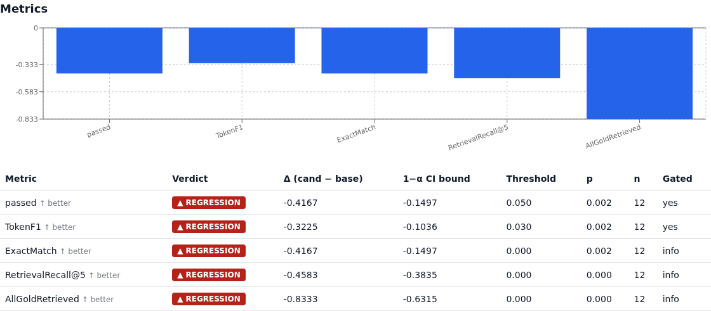
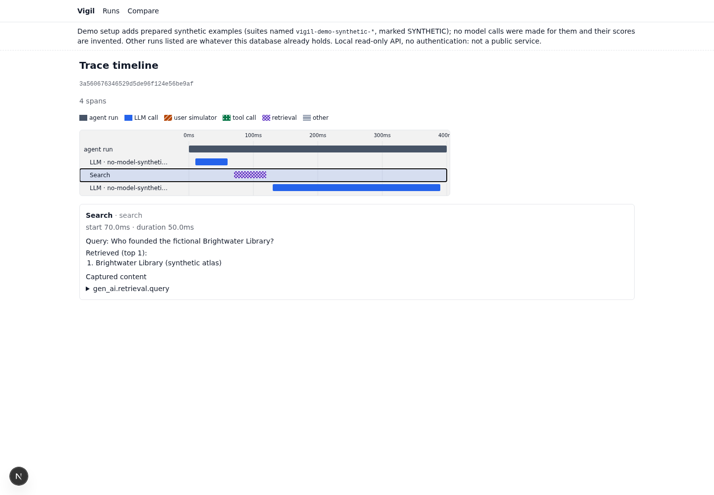

# Vigil demo (no API key)

Two parts, kept apart on purpose:

| | what it is | needs |
|---|---|---|
| **REAL saved evidence** | The frozen evidence bundle of one real, exploratory HotpotQA pilot (run `cafae810`, 40 model-backed units, $0.252951). `make demo-evidence` recomputes its verdict offline with the production gate and refuses tampered files. | Python only: no database, no Docker, no key |
| **SYNTHETIC prepared examples** | A 12-case fixture with invented scores and traces (no agent ran, no model was called), imported into the real Postgres/ClickHouse so the real API, gate and dashboard show one `regression`, one `no_regression` and one `incomplete` comparison. | The local stack, read-only roles, no key |

Nothing here makes a model call, needs `ANTHROPIC_API_KEY`, installs or deletes anything, or is
deployed anywhere. The API is local, read-only and **unauthenticated**: it binds 127.0.0.1 and is
not a public service.

Verification of this demo (local test suites, real-stack seeding, and a final real-Chrome
walkthrough of every scenario through the same-origin proxy, including the rendered metrics
charts, all passed on 2026-10-25; a blank-chart bug found in review was fixed by Recharts
2.12.7 → 2.15.4 and is covered by a mocked-browser test):
[docs/plans/status.md](../docs/plans/status.md), "Current verification". The demo is merged into
`main` (PR #2, `da694e7`); latest hosted CI:
[`main` runs](https://github.com/JCHETAN26/vigil/actions/workflows/ci.yml?query=branch%3Amain).
`make demo-smoke` (below) repeats the browser walkthrough from the repo.

## Screenshots (SYNTHETIC data)

Captured from a real `make demo` dashboard and API (not mocked), showing only the prepared
SYNTHETIC examples: invented scores and traces, no model calls. They are not results.



*SYNTHETIC example: `retrieval_top_k` 5 → 1 on the invented 12-case fixture. The gate reports a
regression on the gated `passed` and `TokenF1`.*



*SYNTHETIC example: the candidate trace of affected case `syn-q02`; the `search` span returned one
passage instead of five.*

## 1. Offline: reproduce the real pilot verdict

```sh
make demo-evidence                      # uses engine/.venv
# or, from a fresh clone with only the SDK and the engine (what CI's `evidence` job does):
python3.12 -m venv /tmp/vigil-min && /tmp/vigil-min/bin/pip install ./sdk-python "./engine[api]"
make demo-evidence DEMO_PY=/tmp/vigil-min/bin/python
```

`demo/evidence.py verify` passes only if all of these hold, and otherwise prints `REFUSED` with
every reason:

1. the five bundle files match the sha256 values pinned in `evidence/hotpotqa-pilot/provenance.json`
   (byte-for-byte copies of the exported bundle), and nothing else is in the bundle;
2. `engine.bundle.verify_bundle` recomputes the verdict from the saved per-(case, trial) rows and
   policy with `engine.gate` and every field matches the saved `verdict.json`;
3. the recomputed verdict says what the provenance claims (run, versions, 20 paired cases,
   `no_regression`, 40 OK units, AllGoldRetrieved −0.30);
4. `span-accounting.json` agrees with the bundle: canonical span cost per version = the units'
   cost, stored span sums = exactly twice that (the double counting fixed in `0e68bd9`).

SciPy is required: the saved bounds use the Student-t quantile, and without SciPy the verifier
says it cannot verify instead of approximating. What the pilot does and does not show:
[evidence/hotpotqa-pilot/README.md](evidence/hotpotqa-pilot/README.md).

## 2. Interactive: `make demo`

Prerequisites (the launcher checks them and stops with a clear message; it does not do them):

```sh
cp .env.example .env && $EDITOR .env      # admin + POSTGRES_RO_* / CLICKHOUSE_RO_* credentials
set -a && . ./.env && set +a              # this shell now has the credentials
(cd ingest && make up && make migrate)    # stack + ClickHouse schema
make -C engine install                    # engine/.venv (once)
make -C engine migrate                    # Postgres schema
deploy/create_readonly_users.sh           # read-only roles (once)
(cd dashboard && npm ci)                  # once
```

Then:

```sh
make demo                         # API 127.0.0.1:8091, dashboard 127.0.0.1:3318
make demo DEMO_API_PORT=8095 DEMO_UI_PORT=3325     # if those ports are taken
```

`make demo` (`demo/launch.py`):

1. refuses an occupied port, equal ports, missing read-only roles/credentials or a missing
   `dashboard/node_modules` before doing anything, and never stops a process it did not start;
2. seeds the SYNTHETIC fixture with the admin credentials (`demo/seed.py seed`, idempotent: a
   second run writes nothing) and checks it read-only (`demo/seed.py check`): the rows are
   identical in both stores and `engine.gate` computes each scenario's expected verdict from them;
3. starts the real API (`python -m engine.api`) with only the read-only credentials (admin
   passwords and every model API key removed from its environment), and the dashboard dev
   server with the demo notice on and `NEXT_PUBLIC_API_URL=/api/vigil`: the browser talks only
   to the dashboard port and the dashboard's server-side proxy forwards GETs to this API;
4. prints the runs page, the three scenario compare links, a trace of an affected case, the real
   pilot's compare link if that run is in your database, and the offline command;
5. on Ctrl-C (or if either process exits) stops the two process groups it started.

Separately: `make demo-seed` (write), `make demo-check` (read-only verify). The seeder never
updates, deletes or merges rows: if any fixture id, name, run, result or span already exists with
different content (or only partly), it refuses the whole seed and writes nothing. It also never
removes the fixture; delete those rows by hand if you want them gone (ids under
`d3e00000-0000-4000-8000-`, names `vigil-demo-synthetic-*`).

### Check a running demo in a browser: `make demo-smoke`

With `make demo` running (default proxy mode), in a second terminal:

```sh
make demo-smoke                                       # http://127.0.0.1:3318, prints a JSON report
make demo-smoke DEMO_UI_PORT=3325                     # the demo on another port
make demo-smoke DEMO_SMOKE_URL=http://127.0.0.1:4318  # e.g. an SSH-forwarded port
make demo-smoke DEMO_SMOKE_ARTIFACTS=demo/smoke-artifacts   # + report.json and screenshots
PLAYWRIGHT_CHROME_PATH=/path/to/chrome make demo-smoke     # a browser other than installed Chrome
```

`demo/smoke.cjs` opens the dashboard in installed Google Chrome (it never downloads a browser) and
checks, through the dashboard's `/api/vigil` proxy against the real read-only API: the demo
notice; the three SYNTHETIC runs; for each scenario, the API verdict and banner, the incomplete
reasons, the changed manifest fields, and the first metric's bar on the correct side of a drawn
zero line; the candidate `syn-q02` trace and its top-1 retrieval; and the run-detail version picker
producing the right compare link. The expected ids, hashes, paths and values come from
`python demo/seed.py links --json`, computed offline from the fixture and `engine.gate`, so
nothing is hardcoded twice. It reads only: no database credentials, no model keys, no writes. It
fails (exit 1, `"ok": false` with the step and reason) on any assertion, page error, failed request,
API error status or request to another origin, and does not need the real pilot in the database.

The base URL must be a loopback `http://` origin (`127.0.0.1`, `localhost` or `[::1]`, any
port); credentials, paths, queries, fragments and other hosts are refused. Artifacts go to a new
`demo-smoke-<UTC time>` directory under the one you give, which is never reused or overwritten
(`demo/smoke-artifacts/` is gitignored). Screenshots show the synthetic examples; on the runs
list every non-synthetic row is masked, so other runs in your database are not captured.

**From another machine over SSH** (replace `<ssh-host>` with yours):

```sh
ssh -N -L 3318:127.0.0.1:3318 <ssh-host>
# then open http://127.0.0.1:3318/runs locally
```

With `--direct-api` (`python demo/launch.py --direct-api`) the browser calls the API port
directly (CORS allows the dashboard origin), so forward both ports:
`ssh -N -L 3318:127.0.0.1:3318 -L 8091:127.0.0.1:8091 <ssh-host>`.

## 3. Presentation script (about 3–5 minutes)

A suggested walkthrough; timings are a guide, not a measured setup time.

1. **Runs page (30 s).** Point at the demo notice: the three `vigil-demo-synthetic-qa` runs are
   prepared, invented data, labelled SYNTHETIC, with their notes. Any other runs are whatever this
   database already held.
2. **A regression, triaged (60–90 s).** Open the `regression` link. The banner says REGRESSION:
   the gated `passed` and `TokenF1` dropped beyond their thresholds with the one-sided bound
   excluding zero. Filter the cases to *adverse*: five cases that passed on the baseline fail on
   the candidate. Open `syn-q02`'s candidate trace: the `search` span returned one passage
   instead of five, and the final answer is wrong.
3. **What changed (30 s).** The version diff on the same page: `params.retrieval_top_k` 5 → 1 and
   the tool description. The version hash is the hash of exactly this config.
4. **No regression (20 s).** Open the `no_regression` link: a reworded prompt, one case better,
   no gated drop.
5. **Incomplete is not a pass (30 s).** Open the `incomplete` link: the candidate run was aborted
   after 8 of 12 cases with one timeout. The gate reports INCOMPLETE with its reasons (run status,
   missing cases, unequal case sets) even though nothing gated regressed.
6. **Real evidence, offline (60 s).** In a terminal: `make demo-evidence`. This is a real pilot:
   20 HotpotQA questions, top_k 5 vs 1, dated Haiku 4.5, 40/40 units, $0.25. The gate found no
   gated regression while AllGoldRetrieved fell 0.30. Say plainly: 20 questions × 1 trial is
   exploratory, not evidence the two configs are equivalent. Edit a copy of the bundle to show it
   is refused (`demo/tests/test_evidence.py` does exactly this).
7. **How it fits together and what is not built (30 s).** The diagram below; then the limits.

## 4. How the pieces fit

```
 agent (SDK: vigil.wrap / spans) ──OTLP──▶ ingest receiver ──▶ Kafka API ──▶ writer ──▶ ClickHouse spans
        ▲                                                                                   │
 engine orchestrator + workers ──results──▶ Postgres (suites, runs, versions, manifests) ──┤
                                                                                            ▼
            engine.gate (one verdict for CLI + API) ◀── read-only FastAPI (RO roles) ◀── dashboard
                    │                                       ▲               (Next.js; /api/vigil proxy)
     regress --save ▼                                       │
        evidence bundle ──▶ make demo-evidence (offline)    └── demo/seed.py writes the SYNTHETIC
                                                                fixture straight into both stores
```

The SYNTHETIC fixture skips the agent, the SDK, the receiver, the queue and the writer: it is
seeded replay data that exercises storage, the gate, the API and the dashboard only. The real
pilot exercised the whole path once.

## 5. Real vs synthetic, at a glance

| | real | synthetic |
|---|---|---|
| HotpotQA pilot `cafae810` (bundle, verdict, unit cost, span reconciliation) | ✓ | |
| Earlier provider-capped attempt `45e1b86b` | real, but not a result | |
| `vigil-demo-synthetic-*` suite, agent, 3 runs, 68 results, traces | | ✓ invented |
| Their verdicts | computed live by `engine.gate` | from invented rows |
| Model name `no-model-synthetic-fixture`, tokens 0, cost unset | | ✓ |

## 6. Limits

- Local only: no authentication, no TLS, nothing deployed. The API is read-only by role grant
  (the launcher requires the RO roles); a public deployment would need real hardening.
- The SYNTHETIC scores, answers, traces and timings are invented; they measure nothing.
- The real pilot is one exploratory run (20 questions, 1 trial): low power, uncalibrated.
- Validation of this demo used the owner's local stack with Kafka 4.1 rather than the pinned
  Redpanda; the paid model suites were not re-run on the final code.
- Seeded spans carry fixed timestamps anchored at 2026-10-25 12:00 UTC and fall under the
  365-day eval-span TTL, so they are retained until about 2027-10-25. Reseeding the same
  timestamps after that would not help (ClickHouse would expire them again), so `seed`, `check`
  and `plan` refuse from one day before that date with a clear message: move the fixture's date
  anchor (`_T0`) forward and bump `FIXTURE_VERSION` in `demo/synthetic_fixture.py`. Retention
  itself is not changed for the demo. While only some seeded spans are gone, the seeder refuses
  the partial set. The spans also feed the on-insert rollups (`trace_index`,
  `agent_version_stats_daily`) with zero cost.
- The fixture is deliberately small (12 cases, 68 results, a few hundred spans).
